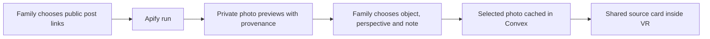

# Apify memory sources

The family can import selected public Instagram photo posts, review individual carousel photos, add their own note and attach a photo to an object and perspective. A direct family-photo upload is also available without an Apify token. A native VR card shows the photo, author and family note; the original telling and its illustration choices stay separate. The [place and optional 3D object workflow](PLACE_OBJECTS.md) now uses these reviewed photos in both the general Gate experience and the separate Red Kite example.



## Start and try it without a token

Use the existing local backend. In a fresh checkout, install the root and Gate lockfiles, start local services and seed the already-cached meadow:

```sh
npm ci
npm --prefix apps/gate ci
npm run local:up
npm run demo:kite
npm --prefix apps/gate run dev
```

`local:up` retains the existing IWSDK/phone setup and needs their dependencies plus SpacetimeDB as described in the root README. If those services already run, leave them running and start only Gate. The Gate route uses Convex and the cached World Labs asset; it does not require SpacetimeDB to import photos. No VR store, headset build configuration or paid world-generation flags were changed for this feature.

Open `https://localhost:5180/?story=red-kite`. Choose **Photo sources**, confirm permission, then **Try fictional kite example**. Add a note such as “The cream ribbon reminds me of the one we tied together.” Select **The kite** and **Elena**, then **Attach reviewed photo**. This example uses our original labeled illustration and makes no Apify request.

In Quest VR, use the **Photo sources** button in the native panel, or point at the visible kite and select. The photo and note are actual Three objects inside the XR scene, not a DOM overlay. **A** goes to the next photo while the source card is open; the in-world **Back to the story** button restores the usual A behavior. **B** rests, **X** changes telling and **Y** exits as before. The photo list follows the chosen perspective. The normal story controls still progress the kite's color and ribbon using the existing source-linked choices.

For a shared demonstration, use **Invite a viewer** on the host laptop and open that link on the headset using the laptop's LAN address. Only the host/family sees draft previews or author controls. Viewer selection of a perspective remains local. Removing a source updates the joined viewer immediately. Use the existing HTTPS/certificate setup; no extra Quest permissions are requested.

## Enable real Apify imports

There is **no Apify token available in this checkout**. The cloud adapter is implemented and tested with controlled API responses, but a real Instagram cloud run and cloud publication of the custom Actor have not been verified.

Put these entries in the existing ignored `.env.exchange`, or in `auth/memory-gate.env` (or the file selected by `MEMORY_GATE_ENV`; `MEMGATE_AUTH_FILE` is also accepted):

```dotenv
APIFY_TOKEN=your-private-token
ALLOW_APIFY_CLOUD=1
# Optional: publish the custom Source Atlas Actor, then set its ID here.
# APIFY_MEMORY_ACTOR_ID=your-account~heirloom-historical-memory-atlas
```

Run `npm run env:push` against the running **local** Convex backend. This provisions the same server token used by the archive gateway. A private provider file takes precedence over process/exchange defaults in both launch paths. No `VITE_` variable, client bundle or committed file contains the token. No other provider flag needs enabling. Restart the archive gateway only if you changed its environment too.

The normal browser-owned Red Kite sample is immutable offline mode. **Open a live import copy** in the sources panel, or visit `https://localhost:5180/?story=red-kite&sources=live`. It creates a separate cached-meadow room that accepts explicit imports. Existing sample state, controller configuration and world generation limits stay intact. Enter one to three public `https://www.instagram.com/p/.../` URLs, confirm permission, and choose **Import with Apify**. Wait for the previews, review the source, then attach a photo. Missing/private posts and videos return an honest empty/error state.

Without `APIFY_MEMORY_ACTOR_ID`, the application calls the official [Apify Instagram Scraper](https://apify.com/apify/instagram-scraper/api) directly using its documented `directUrls`, `resultsType: posts`, and bounded `resultsLimit`. With that variable, the application runs our [custom Actor](../actors/historical-memory-atlas/README.md) in social mode. It orchestrates that official scraper and produces memory source cards. Publish it using the [Apify CLI deployment workflow](https://docs.apify.com/actors/development/deployment) from `actors/historical-memory-atlas` (`apify login`, then `apify push`), save its ID and run `env:push` again. Existing `APIFY_ACTOR_ID` continues to select the archive gateway's Actor; it is intentionally a separate setting.

The application saves the parent run ID immediately and resumes that run after reload. The custom Actor also saves its child run ID. API failures never silently create a second run. Inspect a failed/ambiguous start in Apify Console before retrying. The application sends a 180-second timeout and `maxTotalChargeUsd: 0.10`; those request settings are not an account-level or parent-plus-child spending guarantee. One active import and a one-minute cloud cooldown apply per room. Up to eight photos are accepted per import and 32 source cards per room. Only the selected photo is copied to app storage (JPEG, PNG or WebP, at most 5 MB); its XR texture is resized to at most 768 pixels on a side. Expired preview URLs require re-importing the post.

## Other memory objects and 3D use

The same source-card record and review flow accept **flower** and **landmark** attachments. They appear in the source library and the native photo browser for that perspective. Selecting the kite filters directly to its own cards. A flower photo can carry a family note about a garden; a landmark post can carry a note about a familiar park or trip. **Make optional 3D object** opens the new workshop. Original bridge, bench and flower-planter models, the existing kite and the room's library models are available. No Quest passthrough camera access is used.

Apify supplies photos, captions, place metadata and provenance. Caption-derived object suggestions help a person choose the relevant object; they do not identify a flower species, prove that an event happened, or generate a GLB. The existing Three/R3F scene renders the approved source and model. Separately consented, reviewed family photos can use Tripo v3 image-to-3D; generated models stay private until another explicit placement approval. Map photos are linked at their source and are not automatically downloaded or submitted to a model service. No World Labs generation is added by this workflow. See the [complete contract and limits](PLACE_OBJECTS.md).

For the demo story: a family photo becomes a gentle cue beside the kite, then the person chooses whether to tell more. A new volunteered detail can be preserved in their own words using the product's existing recording flow. Do not claim that retrieved photos establish a forgotten detail or that the prototype restores memory.

## Checks

```sh
npm test
npm run test:atlas
npm run test:exchange
npm --prefix apps/gate run typecheck
npm --prefix apps/gate run build
node apps/gate/scripts/memory-sources-check.mjs
npm run test:place-objects
npm run test:red-kite
```

Verified on this branch: 117 backend/contract tests, 12 Actor tests, seven actual SpacetimeDB/gateway integration checks, production build, root/Gate typechecks, four photo-source browser-to-Convex-to-XR checks, eight optional-object checks across the main and kite routes, 11 existing Red Kite browser checks and eight existing native XR emulator checks. The photo flow verifies permission, private previews, family approval, persistence after reload, viewer updates, the actual XR photo texture, rest, POV switching and removal. Storage tests verify caching and cleanup when a pause arrives during download; session tests verify that a live source copy preserves the offline sample's identity. The custom Actor also retrieved two real Library of Congress references locally through Apify SDK 3.7.0; that local archive run needed no cloud token. The [current object verification](../evidence/place-objects/verification.json) records the added coverage and unverified provider/hardware paths.

Browser evidence is written under ignored `.logs/apify-evidence/` with no member tokens; a compact [verification report](../evidence/apify/verification.json) and [stereo source-card view](../evidence/apify/native-photo.jpg) are committed. Physical Quest comfort, reach and sustained frame rate still need the existing hardware acceptance pass. A live Instagram Apify run needs the missing token.

Deleting a memory removes its source rows, import jobs and app-cached photo files. Revoked membership cannot publish a late response; paused rooms cannot approve or remove sources. Apify Console datasets and the original Instagram posts follow their own retention and deletion controls. Removing a Memory Gate source does not delete the original post or Apify's run history.
