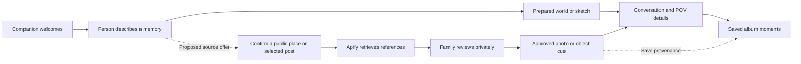

# Main journey and where Apify fits

This describes the main Gate app at `/`, with current `origin/main` through `e78e720` fully included. A fresh fetch found no newer main commits. The separate `/?story=red-kite` experience is also available from the portal and album; it is not the main assistant conversation.

The fetched `origin/interface` branch also contains unmerged XR album, terrain and rendering work. Those commits remain available on that branch. This update uses current main and keeps the discovery add-on independent of those broader changes.

## Current journey

1. **Welcome.** The figure is waiting at the palace. Begin creates or joins the private room and starts the conversation. The companion asks which moment the person would like to visit. A returning visitor can also open the moments album.
2. **Gather the memory.** Choose the grandparent or grandchild perspective, or just look for now. The person talks, uploads a photo/video or invites family to help. Cartesia handles speech recognition and spoken replies when configured; browser speech and offline rules are fallbacks. Claude proposes a short reply, intent and place title. The flow controller applies the result; the guide does not currently call Apify.
3. **Prepare the place.** Words such as “this hill” or “meadow” select the cached fictional Red Kite world; “courtyard” selects the cached courtyard. This is a local library match, not a geolocation lookup or a new world generation. Otherwise the sketch planner makes a scene plan from the person's words, with a simpler offline fallback. A shared photo has its own caption/planning and configured photo-to-world path.
4. **Enter.** The person agrees to go there, the gate transition runs and the world appears. Prepared places load existing assets; the entry does not depend on an Apify search finishing.
5. **Remember inside the place.** Naming a kite in the prepared meadow brings the team's existing kite and spool into the person's hands. Other supported objects appear or move where the words/pointing put them. Unprepared scenes use the detail planner. SpacetimeDB keeps live participant and perspective collaboration, including the boy/grandmother models and walking; each person's viewing POV stays local. Rest and leaving remain available.
6. **Keep the visit.** Arrival, volunteered details and the final view become album moments with scene snapshots, words and consented original audio when available. The visit can be reopened. These are records of what was said and illustrated, not proof that an event happened.

The entry points are `apps/gate/src/flow/controller.ts` (`begin`, `heard`, `placeWords`, `heardInMemory`, `enter`, `leave`), `flow/memory.ts` (planning/media/objects), `flow/moments.ts` (album), and `packages/shared/src/places.ts` (prepared-world matching).

## What Apify currently does in main

The **Places and objects** button is exposed during `forming` and `memory`. It opens the same source workflow verified in the kite example: public place query or selected public post → Apify → private references → family review → optional original model or separately consented image-to-3D → private model preview → explicit placement → native VR source card.

It is currently a manual side workflow. The assistant does not pass a spoken place into it, imported photos do not automatically become the main conversation's uploaded photo, and the album does not yet carry explicit source/object references through its save/reopen path. A phrase such as “this hill” also identifies no real-world park to search.

**Object discovery is also implemented.** Small prompts for the kite, the existing meadow's flowers and tree, supported planned objects and approved optional props open a short public explanation. The existing private Source Atlas Actor retrieves the reference; its publisher, URL and small Apify credit are kept. A native 3D marker/card renders in immersive VR. The flower card treats daisies as an example, not a visual species identification. This retrieval is optional and does not gate entering, speaking, changing POV, adding things or saving a visit.

## Add-on attachment points

`apps/gate/src/memory-addons/MemoryAddOns.tsx` is the only composition file for these optional features. `MemoryAddOnsOverlay` keeps the existing photo/place/3D workshop plus object discovery on screen. `MemoryAddOnsScene` keeps their native 3D counterparts in the world, including headset source cards. Both return fragments, so they add no layout or scene-transform wrapper.

`object-info/targets.ts` turns a read-only snapshot of the plan, current POV and reviewed optional props into annotations. `object-info/sceneHints.ts` holds the existing meadow's authored flower and tree positions. Neither changes the scene plan or creates geometry. Future checked worlds can add hints there; a new external feature can mount its screen and native components in `MemoryAddOns.tsx` without changing the conversation controller, voice, scene planner, album, camera or XR configuration. Credentials and external calls belong on the server, as the existing Apify actions do.

The existing public-post import, Maps references, direct family-photo upload, private review, optional original/library models and consented Tripo path remain separate and available. `objectInfo=off` disables only discovery; it keeps these other add-ons. Existing per-feature boundaries isolate unavailable object context from the memory.

The assistant-driven retrieval and album-provenance connections below are still proposed. Keeping them separate preserves the ability to change the main pipeline later.

## Recommended integration

**First connection: conversation to retrieval.** After the person identifies a place or asks for help finding a photo, the companion offers a source search. For a vague “this hill,” ask which park/town instead of searching the raw transcript. Confirm the public query or selected post links on the family device. Run retrieval beside the conversation, with a visible pending/error state; never hold the gate transition or require the storyteller to manage an import form.

**Second connection: reviewed reference to a cue.** Reuse the existing review and model pipeline. Family chooses a relevant source and can show the approved photo first, or preview an illustrative prop. An imported photo should enter the main photo/planning flow only through an explicit “use this photo” action. A map reference provides context and a link, not a mesh or permission to copy Maps imagery into another service. Selecting a source does not automatically replace the whole world.

**Third connection: cue to the saved memory.** Carry a stable memory ID, source ID, optional object ID, approval and perspective through the album save/revisit path. Prepared-world visits currently have a title fallback for object scope; assign a durable visit identity before attaching retrieved sources. Keep the person's original words separate from the source, family note and generated interpretation.

For the kite demonstration: the person describes flying a kite on a hill; the companion asks which park; family approves a retrieved park reference or a selected family post; the original meadow stays available; an approved photo or small prop becomes a cue. If the person then volunteers a new detail, preserve their exact words and audio as a moment. Use “Does this bring anything to mind?” rather than telling them a retrieved object was part of their childhood.

## Walkthrough verification

The main journey was walked with the actual local backend, main UI, grandparent POV choice and simulated speech in an immutable offline room: portal → companion prompt → spoken hill/kite description → main meadow → manual Apify workshop → additional spoken detail → saved album. All seven steps completed with no page errors and no paid calls. This verifies the navigation and placement of the existing integration; it does not claim a live Cartesia conversation or a physical headset pass. The merged code also passed 126 contract tests, Gate's typecheck and production build. [Walkthrough record](../evidence/main-pipeline/verification.json).
